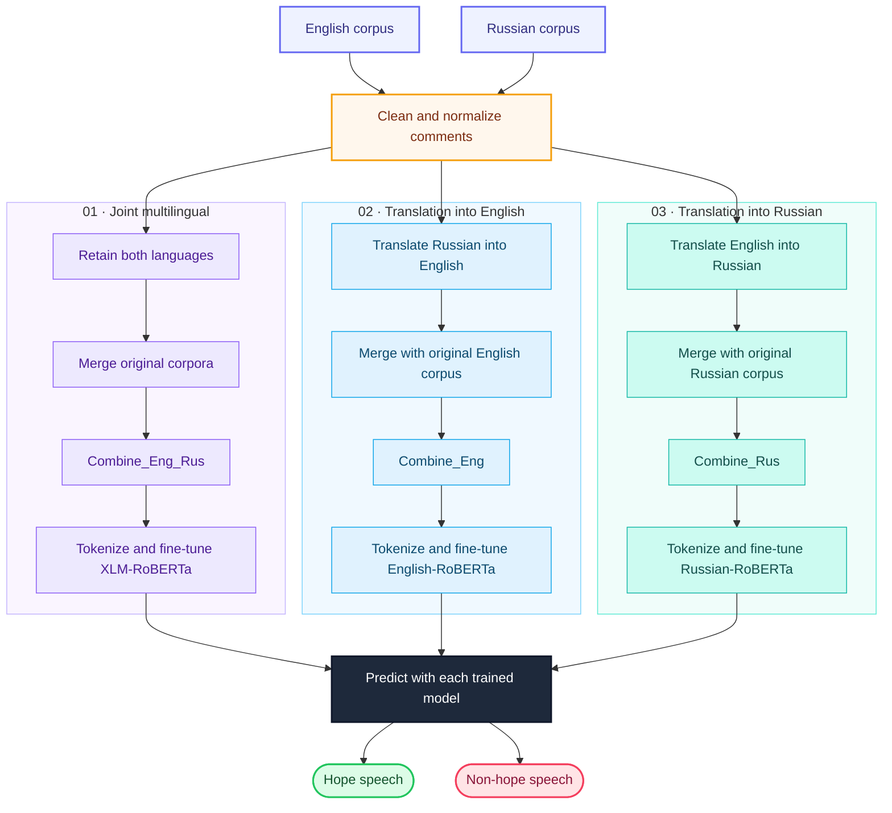

# Hope speech detection datasets

This repository contains datasets for English and Russian languages:

* **Origin_Rus** - dataset for Russian language
* **Origin_Eng** - dataset for English language
* **Combine_Rus** - dataset that contains the **Origin_Rus** and transalted into Russian the **Origin_Eng** dataset
* **Combine_Eng** - dataset that contains the **Combine_Eng** and transalted into English the **Origin_Rus** dataset
* **Combine_Eng_Rus** - dataset that contains the **Combine_Eng** and **Origin_Rus** datasets

|                 | Origin_Rus | Origin_Eng | Combine_Rus, Combine_Eng, Combine_Eng_Rus |
|-----------------|------------|------------|-------------------------------------------|
| All             | 5425       | 29744      | 35169                                     |
| Hope_speech     | 1294       | 2586       | 3880                                      |
| Non_hope_speech | 4131       | 27158      | 31289                                     |


# 🌍 Hope Speech Detection Datasets: English & Russian

**Original corpora · Translation-based datasets · Joint multilingual evaluation**

[](#datasets)
[](#task)
[](https://doi.org/10.1016/j.jksuci.2023.101736)

Datasets for **hope speech detection in English and Russian**, supporting experiments with original-language corpora, translation into a shared language, and joint multilingual classification.

**[Paper](https://doi.org/10.1016/j.jksuci.2023.101736) · [Datasets](#datasets) · [Workflow](#workflow) · [Results](#results) · [Usage](#usage) · [Citation](#citation)**

<a name="research-basis"></a>

## 📄 Research basis

These datasets accompany the study **“Multilingual hope speech detection: A Robust framework using transfer learning of fine-tuning RoBERTa model”**, published in *Journal of King Saud University – Computer and Information Sciences* in 2023.

The paper studies two approaches:

- **Joint multilingual classification:** combine English and Russian comments and fine-tune XLM-RoBERTa.
- **Translation-based classification:** translate comments into a shared language, combine them with that language's base corpus, and fine-tune English-RoBERTa or Russian-RoBERTa.

This is a **dataset repository**. The model descriptions and scores below summarize the paper; they do not imply that model training code or pretrained weights are included here.

<a name="task"></a>

## 🎯 Task

Classify each comment into one of two categories:

| Category | Target |
| --- | --- |
| `Hope_speech` | Hope speech |
| `Non_hope_speech` | Non-hope speech |

Use the released `class` column as the target and inspect its stored values before applying a numeric label mapping.

<a name="datasets"></a>

## 📚 Datasets

| File | Language / representation | Composition |
| --- | --- | --- |
| [Origin_Rus.csv](Origin_Rus.csv) | Russian | Base Russian corpus |
| [Origin_Eng.csv](Origin_Eng.csv) | English | Base English corpus |
| [Combine_Rus.csv](Combine_Rus.csv) | Translation-based Russian | `Origin_Rus` + `Origin_Eng` translated into Russian |
| [Combine_Eng.csv](Combine_Eng.csv) | Translation-based English | `Origin_Eng` + `Origin_Rus` translated into English |
| [Combine_Eng_Rus.csv](Combine_Eng_Rus.csv) | Joint English–Russian | `Origin_Eng` + `Origin_Rus`, retaining their respective languages |

The `Origin_` prefix identifies the base releases used in these combinations. It does not mean that every comment was originally authored in that language: the paper describes constructing the Russian corpus through translation of a Kannada hope-speech dataset, followed by manual review.

### Dataset statistics

| Category | Origin_Rus | Origin_Eng | Each combined dataset |
| --- | ---: | ---: | ---: |
| **Total comments** | **5,425** | **29,744** | **35,169** |
| Hope speech | 1,294 | 2,586 | 3,880 |
| Non-hope speech | 4,131 | 27,158 | 31,289 |

“Each combined dataset” refers separately to `Combine_Rus`, `Combine_Eng`, and `Combine_Eng_Rus`. These are alternative representations of the same combined source material; their totals should not be added to estimate unique comments.

The datasets are imbalanced toward non-hope speech. Report class-wise performance and macro F1 alongside accuracy.

<a name="workflow"></a>

## 🔄 Multilingual Hope Speech Detection Workflow



An original visual summary of the methodology in [Malik et al. (2023)](https://doi.org/10.1016/j.jksuci.2023.101736). The three color-coded paths show joint multilingual learning, translation into English, and translation into Russian. Each path uses its own tokenizer and fine-tuned classifier to predict hope speech or non-hope speech.

### Dataset-to-model mapping

| Approach | Dataset | Model studied in the paper |
| --- | --- | --- |
| Joint multilingual | `Combine_Eng_Rus` | XLM-RoBERTa |
| Translation into English | `Combine_Eng` | English-RoBERTa |
| Translation into Russian | `Combine_Rus` | Russian-RoBERTa |

<a name="results"></a>

## 📊 Published results

The following values are reported in the paper's comparison tables. All scores are percentages and are **paper-reported results**, rather than independently reproduced scores for this repository.

| Approach / model | Accuracy (%) | Hope F1 (%) | Non-hope F1 (%) | Macro F1 (%) | Source |
| --- | ---: | ---: | ---: | ---: | --- |
| Joint multilingual / XLM-RoBERTa | 91.95 | 62.06 | 95.50 | 78.78 | Table 5 |
| Translation into English / English-RoBERTa | 92.20 | 63.32 | 95.63 | 79.48 | Table 7 |
| Translation into Russian / Russian-RoBERTa | **93.57** | **64.01** | **96.47** | **80.24** | Table 8 |

The abstract rounds the Russian approach's accuracy to 94%; the table above uses the precise **93.57%** value reported in the experimental tables.

### Original-corpus splits reported in the paper

The paper uses an 80:20 development/test split, then divides the development portion 90:10 into training and validation data. Table 3 reports these original-corpus counts:

| Corpus | Training | Validation | Test | Total |
| --- | ---: | ---: | ---: | ---: |
| English | 21,415 | 2,380 | 5,949 | 29,744 |
| Russian | 3,906 | 434 | 1,085 | 5,425 |

Retain source-comment identities when constructing new splits so that translations of the same comment remain within the same partition. Document the dataset variant, translation direction, split, and label mapping for each experiment.

<a name="usage"></a>

## 🚀 Usage

Clone the dataset repository:

```bash
git clone https://github.com/Humpty1944/Hope-speech-detection-datasets.git
cd Hope-speech-detection-datasets
```

Install pandas to inspect the CSV files:

```bash
python -m pip install pandas
```

Load an original-language dataset:

```python
import pandas as pd

df = pd.read_csv("Origin_Eng.csv", usecols=["text", "class"])

print(df.head())
print(df["class"].value_counts(dropna=False))
```

The CSV files expose `text` and `class` columns. Some combined files also contain exported index columns, and `Combine_Rus.csv` includes a `Translate_rus` column. Inspect the fields before selecting model input; when using the Russian translation route, select the field containing the Russian text.

```python
combined = pd.read_csv("Combine_Rus.csv")
print(combined.columns.tolist())
print(combined.head())
```

<a name="repository-structure"></a>

## 📁 Repository structure

| Path | Contents |
| --- | --- |
| `README.md` | Dataset descriptions, workflow, results, usage, and citation |
| `Origin_Eng.csv` | Base English corpus |
| `Origin_Rus.csv` | Base Russian corpus |
| `Combine_Eng.csv` | English translation-based corpus |
| `Combine_Rus.csv` | Russian translation-based corpus |
| `Combine_Eng_Rus.csv` | Joint multilingual corpus |
| `workflow.mmd` | Editable Mermaid source for the workflow embedded above |

<a name="citation"></a>

## 📖 Citation

Please cite the associated paper when using these datasets:

```bibtex
@article{malik2023multilingualhope,
  title   = {Multilingual hope speech detection: A Robust framework using transfer learning of fine-tuning RoBERTa model},
  author  = {Malik, Muhammad Shahid Iqbal and Nazarova, Anna and Jamjoom, Mona Mamdouh and Ignatov, Dmitry I.},
  journal = {Journal of King Saud University - Computer and Information Sciences},
  volume  = {35},
  number  = {8},
  pages   = {101736},
  year    = {2023},
  doi     = {10.1016/j.jksuci.2023.101736},
  url     = {https://doi.org/10.1016/j.jksuci.2023.101736}
}
```

Please also acknowledge the source datasets referenced by the paper when using their underlying material and consult their terms for use of the CSV data.
